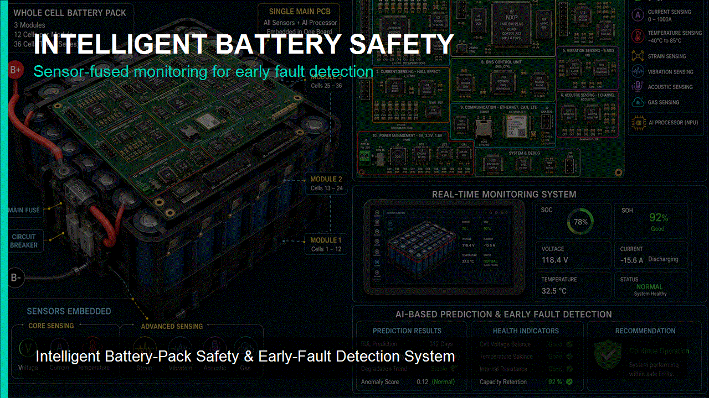
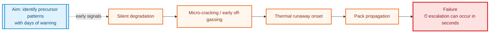
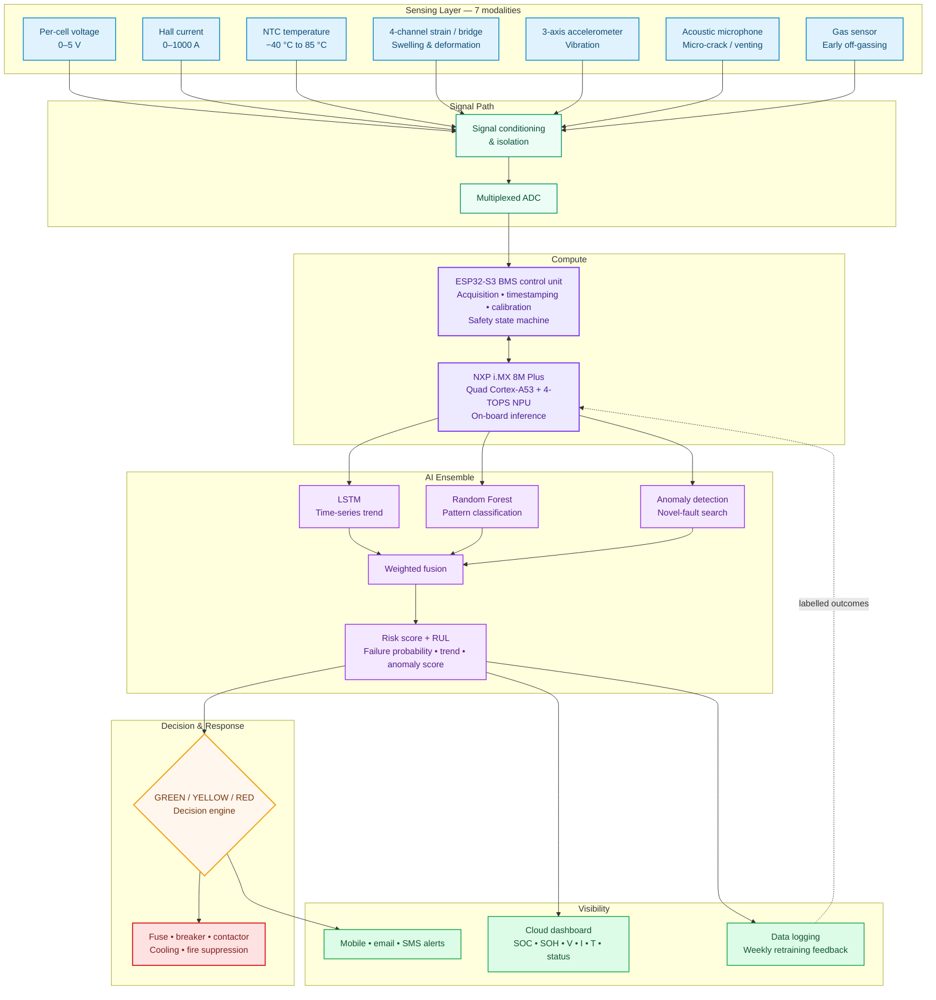
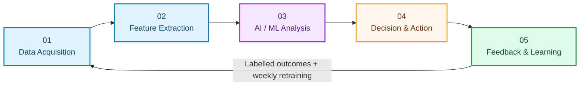
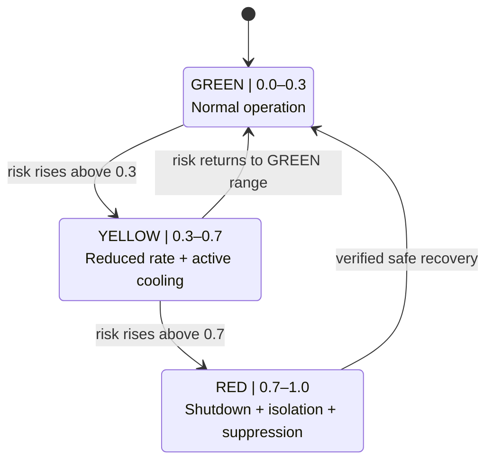
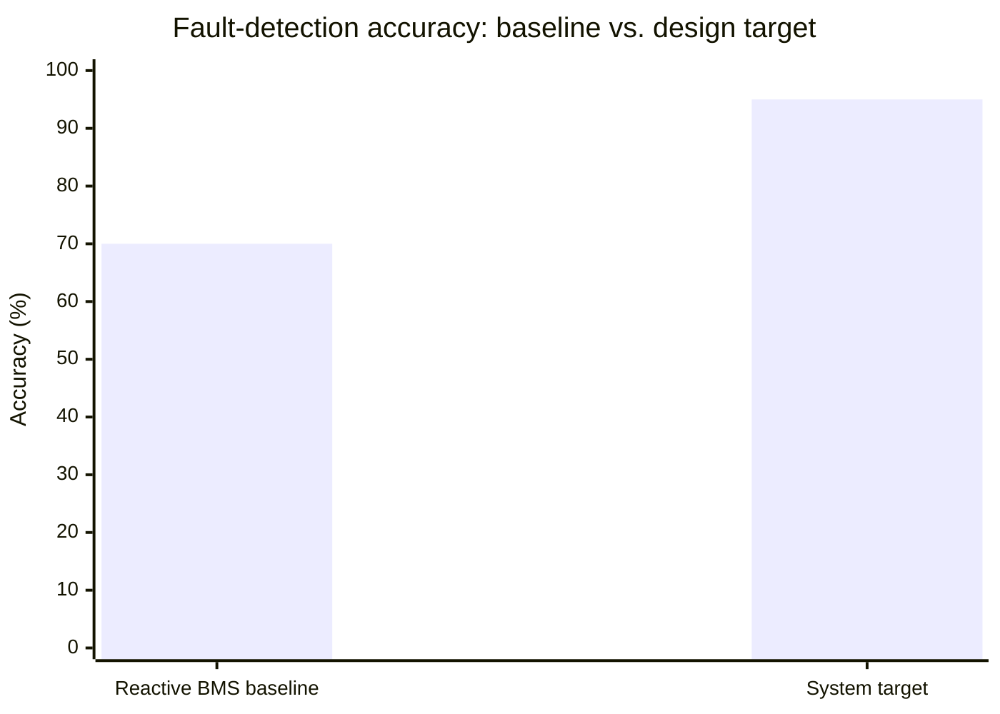

<div align="center">

# Intelligent Battery-Pack Safety and Early-Fault Detection System

<!-- Optional hero asset: add a real image at docs/banner.png or assets/banner.png. -->


<br />


<br />


<br />

<a href="https://github.com/Aruneshw/hacksprint/commits"></a>
<a href="https://github.com/Aruneshw/hacksprint"></a>
<a href="https://github.com/Aruneshw/hacksprint/issues"></a>

<br /><br />

**An AI-powered, sensor-fused Battery Management System add-on that aims to predict Li-ion battery failures days before they happen—not seconds—using one embedded PCB and a three-model AI ensemble.**

</div>

---

## 60-Second Overview

| | Reactive BMS today | This system — design intent |
| --- | --- | --- |
| **Fault timing** | Often detected only after the fault begins, leaving seconds to respond | Detect precursor patterns with a goal of days of warning |
| **Signals** | Primarily reactive operating signals | Seven sensing modalities across electrical, thermal, mechanical, acoustic, and gas behaviour |
| **Accuracy** | ~70% baseline | ≥95% target at TRL 3 — not yet a measured result |
| **Response** | Alarm after detection | Weighted risk score drives GREEN, YELLOW, or RED protection |
| **Operations** | Manual inspection can miss silent degradation | On-board analysis plus cloud status and mobile/email/SMS alerting |

<details>
<summary><strong>Contents</strong></summary>

- [Project Overview](#project-overview)
- [The Problem](#the-problem)
- [System Architecture](#system-architecture)
- [Methodology: The Learning Loop](#methodology-the-learning-loop)
- [AI Decision Logic](#ai-decision-logic)
- [Sensing & Compute](#sensing--compute)
- [Tech Stack](#tech-stack)
- [Impact Snapshot](#impact-snapshot)
- [Applications & Standards](#applications--standards)
- [Repository Structure](#repository-structure)
- [Getting Started](#getting-started)
- [Roadmap](#roadmap)
- [Team](#team)
- [References](#references)
- [License](#license)

</details>

## Project Overview

Battery packs rarely fail without leaving clues. A small voltage imbalance, unusual thermal behaviour, mechanical swelling, vibration, an acoustic signature, or early electrolyte off-gassing can each be a weak signal on its own. This project brings those signals together on one embedded PCB so they can be assessed as a coherent picture of pack health.

At the centre is a three-model ensemble: an LSTM follows degradation over time, a Random Forest classifies known patterns, and anomaly detection searches for what known models have not seen. Their outputs are fused into a real-time risk score for remaining useful life (RUL), failure probability, degradation trend, and anomaly score.

The proposed 36-cell prototype is intentionally framed as **TRL 3 — experimental proof of concept**. The ambition is a practical retrofit or OEM safety module for EVs, energy-storage systems, and industrial battery equipment—not a claim that the finished product has already been validated in the field.

<div align="center">
<br>

<br>


</div>

## The Problem

The most dangerous battery event is often already moving too quickly by the time a conventional safety system reacts. The challenge is separating meaningful early degradation signatures from noise without creating a costly, false-alarm-prone system.

- Commercial BMS units are reactive: they generally identify a fault only after it starts, giving operators seconds rather than hours to react.
- Current baseline fault-detection accuracy is approximately 70%.
- Acoustic and gas sensing have research value, but can be costly and prone to false alarms when not combined intelligently.
- Manual inspection is slow, labour-intensive, and can miss silent cell degradation.
- Once thermal runaway begins, it can propagate through a pack within seconds.



## System Architecture



**Data flow in plain English:** sense → condition → analyse → score → protect → learn. Fast acquisition and safety control stay close to the pack while the AI processor builds an operator-facing risk picture.

## Methodology: The Learning Loop



<details><summary><strong>01 — Data Acquisition</strong></summary>
All seven sensor signals are sampled by cell or module as applicable, then filtered and scaled before analysis.
</details>

<details><summary><strong>02 — Feature Extraction</strong></summary>
Features include cell imbalance, voltage-drop rate, SOC, SOH, and indicators relevant to RUL.
</details>

<details><summary><strong>03 — AI / ML Analysis</strong></summary>
The LSTM models time-series degradation, Random Forest classifies patterns, and anomaly detection searches for unfamiliar behaviour before weighted fusion.
</details>

<details><summary><strong>04 — Decision & Action</strong></summary>
The decision engine maps risk to GREEN, YELLOW, or RED actions, scaling from normal operation to shutdown and isolation.
</details>

<details><summary><strong>05 — Feedback & Learning</strong></summary>
Field and lab fault-injection outcomes (overcharge, over-discharge, and thermal abuse) are labelled for planned weekly retraining. NASA Li-ion and CALCE data support the training approach.
</details>

## AI Decision Logic



| State | Risk score | Automatic action |
| --- | --- | --- |
| 🟢 **GREEN** | 0.0–0.3 | Normal operation. |
| 🟡 **YELLOW** | 0.3–0.7 | Reduce charge/discharge rate and activate cooling. |
| 🔴 **RED** | 0.7–1.0 | Immediate shutdown, isolation, and fire-suppression response. |

> RED-to-GREEN represents recovery only after the system has been verified safe; it is not an automatic bypass of a critical event.

## Sensing & Compute

<details>
<summary><strong>Full sensor specification</strong></summary>

| Sensor | Contribution | Range / implementation |
| --- | --- | --- |
| Per-cell voltage | Cell health and imbalance | 0–5 V |
| Hall-effect current | Pack-level draw | 0–1000 A |
| NTC temperature | Per-module thermal monitoring | −40 °C to 85 °C |
| 4-channel strain / bridge | Swelling and deformation | 4 channels |
| 3-axis vibration accelerometer | Structural anomaly detection | 3 axes |
| Acoustic microphone | Micro-crack and venting sound | Single channel |
| Gas sensor | Electrolyte off-gassing | Single channel |

</details>

| Layer | Planned responsibility |
| --- | --- |
| **AI processor** | NXP i.MX 8M Plus (Quad Cortex-A53 + 4-TOPS NPU) for on-board inference. |
| **Control MCU** | ESP32-S3 with Wi-Fi/BLE for acquisition, timestamping, calibration, and safety state machine. |
| **Production path** | STM32 upgrade path planned for production-grade determinism. |
| **Communications** | Ethernet, CAN, and LTE. |
| **Power / protection** | 5 V, 3.3 V, 1.8 V rails; main fuse, circuit breaker, and contactor. |

## Tech Stack

<!-- CONFIRM before removing TBD labels: the supplied workspace contains no source code, manifests, or build configuration. -->

| Category | Confirmed or planned platform |
| --- | --- |
| ⚙️ **Hardware** |    |
| 🧩 **Embedded** |    |
| 🧠 **AI / ML** |     |
| ☁️ **Cloud / dashboard** |    |

## Impact Snapshot

### 🎯 Design targets — not measured results

| Metric | Target |
| --- | --- |
| Fault-detection accuracy | ≥95% (vs. ~70% baseline) |
| Incremental hardware cost | ~$500 per 200-cell pack |
| Battery-fire reduction | Up to 80% |
| Unplanned-downtime reduction | Up to 60% |
| Battery-life extension | 15–25% |
| Payback period | Under 1 month |



The chart communicates the stated baseline and target only; it does **not** represent completed validation.

## Applications & Standards

| Intended applications | Standards alignment |
| --- | --- |
| Electric vehicles (EVs) | AIS-156 (India) |
| Grid-scale Energy Storage Systems (ESS) | IEC 62619 |
| Industrial battery equipment | UL 1973 |
|  | UL 2580 |
|  | BIS requirements, where applicable |

**Core subjects:** Embedded Systems · BMS · AI/ML · IoT · Power Electronics

## Repository Structure

The supplied workspace currently contains only this README; no firmware, model code, hardware files, package manifest, or build configuration is present. This tree reflects the actual workspace rather than inventing folders that do not exist.

```text
.
└── README.md
```

## Getting Started

There are no build or runtime files in the supplied workspace, so it would be inaccurate to publish installation, flashing, training, or dashboard commands. Add this section when the repository contains the corresponding real tooling.

## Roadmap

These are planning-stage estimates to communicate direction at TRL 3, not test evidence or release milestones.

| Phase | Planning signal | Status |
| --- | --- | --- |
| System design & sensor selection | `████████░░` 80% | Architecture defined; subject to prototype review |
| PCB integration | `████░░░░░░` 40% | In development |
| AI ensemble development | `████░░░░░░` 40% | In development |
| 36-cell prototype validation | `██░░░░░░░░` 20% | Planned |
| Field pilot | `░░░░░░░░░░` 0% | Planned after prototype validation |
| Patent filing | `░░░░░░░░░░` 0% | Potential outcome |
| Ensemble RUL publication | `░░░░░░░░░░` 0% | Potential outcome |

**Intended progression:** working 36-cell prototype → market-ready retrofit/OEM safety module → potential patent and publication → Safety-as-a-Service for EV fleets and ESS operators.

## Team

**Team ID:** <code>SL_ES_MP_07</code>    
**Institution:** Bannari Amman Institute of Technology (Autonomous, Affiliated to Anna University, Chennai)

| Name | Role |
| --- | --- |
| Aruneshwaran K | **Team Leader** |
| Harinisri M | Team Member |
| Hemavarthini V B | Team Member |
| Varunraj V K | Team Member |
| Praveen A | Team Member |
| Mukesh S | Team Member |
| Sundar S (EE1908) | Faculty Mentor |

## References

1. Hannan, M. A., Lipu, M. S. H., Hussain, A., and Mohamed, A. “A Review of Lithium-Ion Battery State of Charge Estimation and Management System in Electric Vehicle Applications.” *Renewable and Sustainable Energy Reviews*, vol. 78, 2017.
2. Severson, K. A., et al. “Data-Driven Prediction of Battery Cycle Life Before Capacity Degradation.” *Nature Energy*, vol. 4, 2019.
3. Government of India, Ministry of Road Transport and Highways. *AIS-156: Electric Vehicles Battery Pack Safety Requirements.*
4. UL. *UL 1973: Standard for Batteries for Use in Stationary, Vehicle Auxiliary Power and Light Electric Rail Applications.*
5. IEC. *IEC 62619: Secondary Cells and Batteries Containing Alkaline or Other Non-Acid Electrolytes — Safety Requirements.*

## License


This README is prepared for an MIT-licensed repository, as requested. A <code>LICENSE</code> file was not present in the supplied workspace—add the official MIT license text and confirm the license choice before publishing or distributing the project.

---

<div align="center">

Built for <strong>HACKSPRINT Phase 1 — Ideathon Hackathon, 2026</strong><br />
at Bannari Amman Institute of Technology

<br />


<br /><br />

<em>Turning a silent battery hazard into a system that speaks up—days before it matters.</em>

</div>
