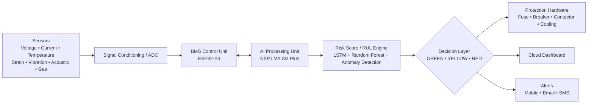
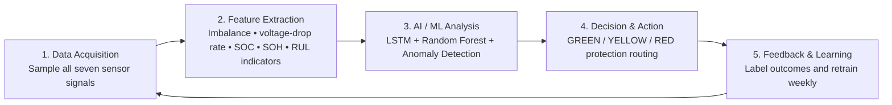

# Intelligent Battery-Pack Safety and Early-Fault Detection System

<!-- Optional: add docs/banner.png or assets/banner.png, then place it above this heading as the project banner. -->

<p align="center">
  
</p>

<p align="center">
  
  
  
  
  
</p>

<p align="center">
  <a href="https://github.com/Aruneshw/hacksprint/stargazers"></a>
  <a href="https://github.com/Aruneshw/hacksprint/network/members"></a>
  <a href="https://github.com/Aruneshw/hacksprint/commits"></a>
</p>

> An AI-powered, sensor-fused Battery Management System (BMS) add-on designed to predict Li-ion battery failures days before they happen, using a single embedded PCB and a three-model AI ensemble.

<!-- Optional: insert docs/dashboard-preview.gif here when a real dashboard preview is available. -->

## Table of Contents

- [Overview](#overview)
- [The Problem](#the-problem)
- [Our Solution](#our-solution)
- [System Architecture](#system-architecture)
- [Methodology](#methodology)
- [Tech Stack](#tech-stack)
- [Impact Targets](#impact-targets)
- [Repository Structure](#repository-structure)
- [Getting Started](#getting-started)
- [Team](#team)
- [Roadmap](#roadmap)
- [References](#references)
- [License](#license)

## Overview

Commercial BMS platforms often identify faults only after they begin, leaving only seconds to react to fast-moving hazards such as thermal runaway. This project combines electrical, thermal, mechanical, acoustic, and gas sensing with on-device intelligence to detect early degradation patterns. Its fused risk score supports practical, escalating actions—from normal operation to isolation and fire suppression—while giving operators live visibility through a cloud dashboard.

Built for **HACKSPRINT Phase 1 — Ideathon Hackathon** in the **Energy Security** domain, the project is currently at **TRL 3: experimental proof of concept**.

## The Problem

- Conventional BMS platforms are largely reactive, with typical fault-detection accuracy near 70% and minimal warning time.
- Manual battery inspection is slow, difficult to scale, and can expose technicians to unsafe conditions.
- Once thermal runaway begins, it can propagate through a pack within seconds, risking assets and people.
- Operators need actionable prediction of degradation and remaining useful life—not only a post-fault alarm.

## Our Solution

### Hardware

The planned prototype uses one main PCB on a 3-module, 36-cell Li-ion pack (12 cells per module).

| Component | Function |
| --- | --- |
| Per-cell voltage sensing (0–5 V) | Tracks voltage, imbalance, and voltage-drop trends. |
| Hall-effect current sensing (0–1000 A) | Measures pack current for load and fault analysis. |
| NTC temperature sensing (−40 °C to 85 °C) | Monitors module temperatures and thermal changes. |
| 4-channel strain / bridge sensing | Detects mechanical stress and deformation. |
| 3-axis vibration accelerometer | Captures impact and vibration signatures. |
| Acoustic microphone | Detects abnormal acoustic events. |
| Gas sensor | Adds an early indicator of gas-emission events. |
| NXP i.MX 8M Plus | Runs on-board inference on a Quad Cortex-A53 processor with a 4-TOPS NPU. |
| ESP32-S3 | Performs sensor acquisition, timestamping, calibration, and safety-state control; STM32 is a planned production upgrade path. |
| Ethernet / CAN / LTE | Supports vehicle, local, and cloud communications. |
| Fuse, circuit breaker, and contactor | Provides protection and pack isolation. |

### Software and AI

| Component | Function |
| --- | --- |
| LSTM | Learns time-series trends for degradation and failure forecasting. |
| Random Forest | Classifies multi-sensor fault patterns. |
| Anomaly Detection | Finds outlier behaviour not covered by known fault classes. |
| Risk-score fusion | Combines the three model outputs into a weighted real-time risk score. |
| RUL and degradation analytics | Produces remaining useful life, failure probability, degradation trend, and anomaly score. |
| Decision engine | Routes a risk score to protection actions and operator notifications. |
| Cloud dashboard | Shows live SOC, SOH, voltage, current, temperature, and system status. |
| Retraining workflow | Uses weekly field and lab fault-injection outcomes; NASA Li-ion and CALCE data support pre-training. |

## System Architecture



### Safety States

| State | Risk score | Action |
| --- | --- | --- |
| GREEN | 0.0–0.3 | Normal operation. |
| YELLOW | 0.3–0.7 | Reduce power and enable cooling. |
| RED | 0.7–1.0 | Shut down, isolate, and trigger fire-suppression response. |

## Methodology



## Tech Stack

<p>
  
  
  
  
  
  
  
  
  
</p>

> Framework, RTOS, dashboard, and cloud-provider choices are planned or to be confirmed; this README intentionally does not claim they are already implemented.

## Impact Targets

| Metric | Target |
| --- | --- |
| Fault-detection accuracy | ≥95% (vs. ~70% baseline) |
| Incremental hardware cost | ~$500 per 200-cell pack |
| Battery-fire reduction | Up to 80% |
| Unplanned-downtime reduction | Up to 60% |
| Battery-life extension | 15–25% |
| Payback period | Under 1 month |

The system is designed to align with AIS-156 (India), IEC 62619, UL 1973, UL 2580, and applicable BIS requirements. Target applications include EVs, grid-scale energy-storage systems, and industrial equipment.

## Repository Structure

The workspace supplied for this README does not yet contain project folders. As implementation artifacts are added, organise them using a structure such as:

```text
├── firmware/          # ESP32-S3 / STM32 embedded code
├── ai-models/         # LSTM, Random Forest, anomaly-detection training and inference
├── hardware/          # PCB schematics, sensor wiring, BOM
├── dashboard/         # Cloud/web monitoring dashboard
├── docs/              # Report, diagrams, datasheets
├── data/              # Sample/public datasets (NASA Li-ion, CALCE)
└── README.md
```

## Getting Started

Build and setup files have not been supplied in the current workspace, so no installation commands are documented yet. Once firmware, model, or dashboard tooling is committed, add the exact prerequisites, dependency installation, flashing, and run commands here.

## Team

**Team ID:** SL_ES_MP_07  
**Institution:** Bannari Amman Institute of Technology (Autonomous, Affiliated to Anna University, Chennai)

| Name | Role |
| --- | --- |
| Aruneshwaran K | Team Leader |
| Harinisri M | Team Member |
| Hemavarthini V B | Team Member |
| Varunraj V K | Team Member |
| Praveen A | Team Member |
| Mukesh S | Team Member |
| Sundar S (EE1908) | Faculty Mentor |

## Roadmap

- [x] Design and sensor selection
- [ ] PCB integration — in progress
- [ ] AI ensemble training — in progress
- [ ] 36-cell prototype validation — planned
- [ ] Field pilot — planned
- [ ] Patent filing — potential
- [ ] Publication on the LSTM + RF + anomaly-detection ensemble — potential

Expected project outcomes include a working 36-cell prototype, a market-ready retrofit/OEM safety module, potential patent and publication opportunities, and a Safety-as-a-Service model for EV fleets and ESS operators.

## References

The report’s five reference entries were not included with this repository brief. Add their full bibliographic details here before publication; the following source categories are currently used by the project:

1. NASA Prognostics Center of Excellence — Li-ion Battery Aging Datasets.
2. University of Maryland CALCE Battery Research Group — battery datasets and research resources.
3. Automotive Industry Standard AIS-156 — safety requirements for traction-battery systems.
4. IEC 62619 — safety requirements for industrial secondary lithium cells and batteries.
5. UL 1973 and UL 2580 — battery safety standards for stationary, motive auxiliary, and electric-vehicle applications.

## License

No `LICENSE` file was available in the supplied workspace. The intended license is **to be confirmed**; add an MIT license only after the repository owner confirms that choice.

---

<p align="center">
  Built for HACKSPRINT Phase 1 — Ideathon Hackathon, 2026<br />
  
</p>
